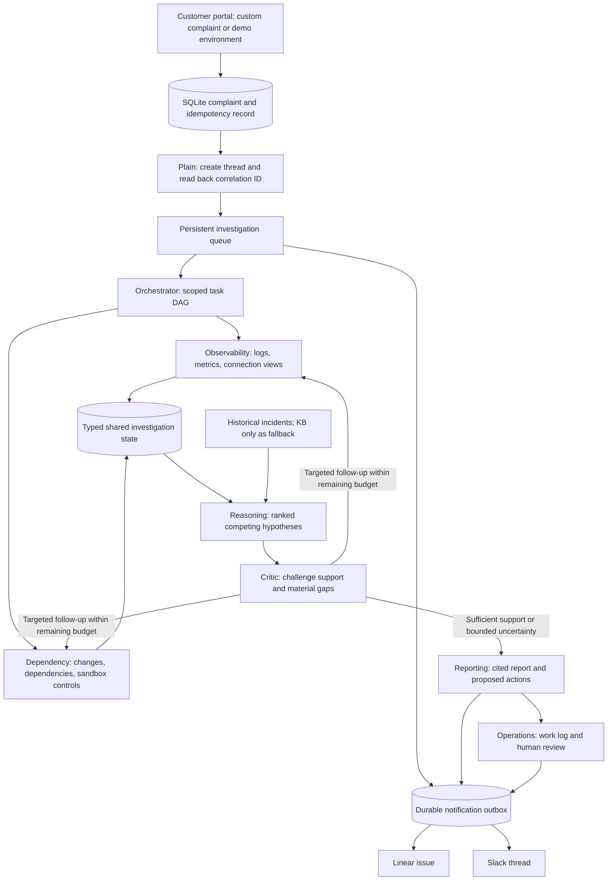

# Architecture and agent coordination

## Operational path

Plain is optional. In simulated mode, local intake creates an explicitly simulated Plain event. The live adapter creates and reads the specific portal-originated thread; it does not poll the entire workspace. The immutable original complaint remains the investigation input; Plain's generated summary is stored separately. A custom complaint never borrows a prepared scenario's observations.

## Six distinct roles

| Role | Responsibility | Tool capability |
| --- | --- | --- |
| Orchestrator | Scope the incident and create independent and dependent questions | No evidence queries |
| Observability | Examine symptoms, affected tenants, failure rate, backlog, latency and credentials | logs, metrics, connections, refresh_history |
| Dependency | Examine releases, configuration, upstream dependencies and available comparisons | deployments, dependencies, reproduce |
| Reasoning | Compare causes, gather relevant history, propose ranked candidates and material missing checks | history; knowledge as fallback |
| Critic | Check grounding, alternatives and unresolved material checks; request bounded follow-up | No direct evidence queries |
| Reporting | Produce aligned hypotheses, findings, confidence, assumptions, limitations and proposed actions | No direct evidence queries |

The engine passes isolated snapshots of typed `State` and accepts typed `AgentResult` objects. Independent observability and dependency tasks execute concurrently. Reasoning waits for both; critic consumes the shared evidence and candidates. Follow-ups form new dependent tasks followed by reassessment and critique. This is a task graph with shared evidence and conditional feedback, rather than six disconnected prompts.

Tools return a structured envelope: original query, attempt, status, completeness, observed records, warning/error and evidence ID. Every record has a stable ID. Finding citations must reference a record actually observed in the trace; derived connection/refresh views do not count as independent causal corroboration. The reproduction tool reads authored sandbox controls, not a live experiment.

## Reliability and bounds

The live runtime defaults to 24 evidence attempts (including retries), 24 provider requests, 20 tasks, two follow-up rounds, a 360-second deadline, 4,000 output tokens per model response, 100,000 characters per request and 700,000 cumulative context characters. These are caps, not a preallocated shared total-token budget. Provider usage is recorded; unreported interrupted usage is not reconciled to billing. Provider requests have bounded transport/validation recovery. Tool retries default to two attempts.

The engine validates task dependencies, tool permissions, observed citation IDs and candidate/report alignment. A runtime failure is recorded as a failure, not rewarded as correct abstention. Insufficient evidence may yield a completed inconclusive report. Identical observations are compacted for context while differing records, failed queries and the complete external trace remain available. Remaining context/request capacity bounds critic follow-ups so reporting can finish.

SQLite records intake, activity, results, feedback and delivery jobs. Restarted investigations are marked interrupted and require explicit retry; this is not resumable model checkpointing. Explicit reinvestigation keeps the same Plain thread and integration references, with a separate attempt history. Outbound calls are not transactions across external services: uncertain creates require inspection/reconciliation rather than blind duplicate creation.

## Evidence boundary and limitations

Prepared environments use invented telemetry informed by public Composio troubleshooting guides. Custom issues use only their supplied observations, with missing sources marked incomplete. No live provider telemetry, automatic refresh, patch deployment, customer messaging or enrichment is connected. KB is a last-priority reference: labeled guidance and a source URL are required, and KB alone cannot establish an incident cause. Shared KB retrieval is not implemented for custom issues.

The model receives an incident, public closed-set vocabulary and permitted tool results—not evaluator labels or fixture files. The adapters do not give the GPT agents shell/file access. The repository itself is not a security sandbox. This loopback prototype lacks authentication, tenant isolation and production deployment hardening.

Normal operations use GPT-5.4 for reasoning/critique and GPT-4.1 mini elsewhere. The preserved matched comparison used GPT-5.4 for both architectures and all team roles. Later operational revisions, including context recovery and KB policy, are not retrospectively scored by that benchmark. See [results](comparison-results.md).

## Vercel deployment adapter

The separate `app.py` entrypoint initializes no database during build, requires a shared reviewer login before accessing application routes, and uses Postgres for the inbox, event log and outbox. Native Vercel Queues invoke two private consumers for targeted investigation and notification jobs; cold starts do not run the local background loops or globally mark other work interrupted. Claims are atomic, completed inference is not replayed on redelivery, and an expired worker lease requires explicit retry. Hosted model execution has a 240-second deadline within the 300-second function maximum. Scratch files are temporary; canonical reports and activity remain in Postgres. See [deployment setup and limitations](vercel-deployment.md). This adapter does not change the preserved benchmark or provide multi-user tenant isolation.
